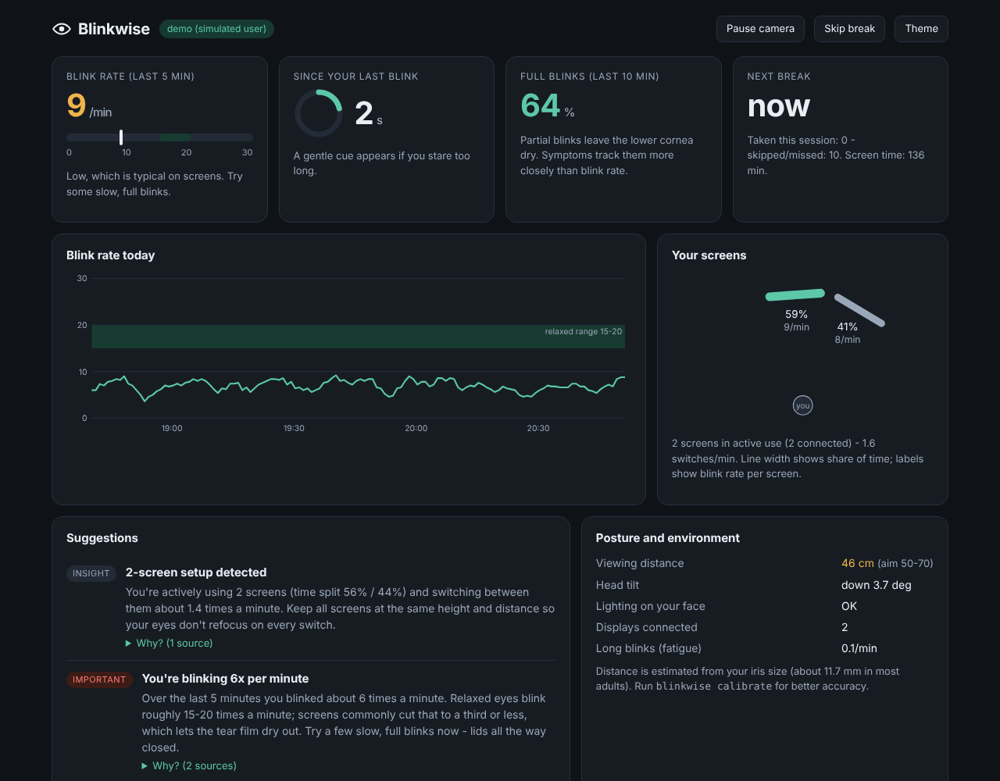
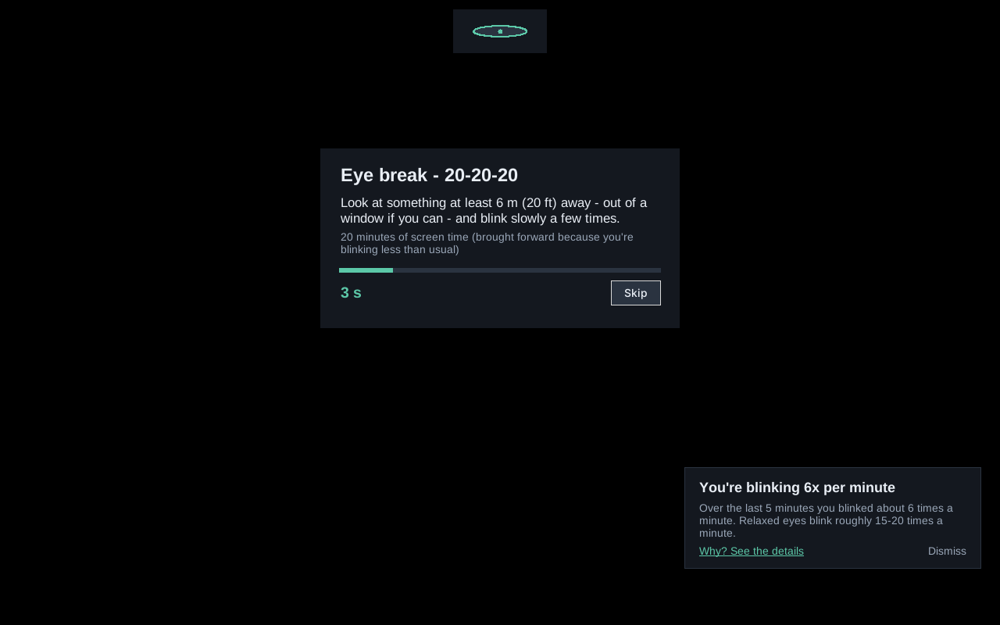

# Blinkwise

**A private, on-device webcam coach for your eyes.** Blinkwise watches how you blink while you use screens. It also tracks how many screens you actually use, how close you sit, and when you last took a break. From that it gives you a few well-timed, evidence-backed nudges.

Everything runs locally. No images are stored or sent anywhere.



## Why

Relaxed eyes blink about 15-20 times a minute. On a screen that typically falls to a third or less ([Patel 1991](https://pubmed.ncbi.nlm.nih.gov/1766652/)), and more of the blinks that do happen are only *partial*. Partial blinks turn out to matter as much as the count: eye-strain symptoms track the share of incomplete blinks more closely than blink rate ([Portello 2013](https://pubmed.ncbi.nlm.nih.gov/?term=Blink+rate,+incomplete+blinks+and+computer+vision+syndrome)). Roughly half of all computer users report digital eye strain. A generation that grows up on two or three screens at once gets more of it, and earlier.

The fixes are simple (blink fully, look far away regularly, sit at arm's length), but nobody remembers to do them. A camera can notice when you've stopped.

## What it does

| | |
|---|---|
| **Blink tracking** | Counts blinks and measures each one: complete or partial, short or long (fatigue). It adapts to your eyes, your glasses and your head position. |
| **Stare cue** | If you haven't blinked for 10 s, a small eye blinks twice at the top of your screen. Blink along with it. On-screen blink animations raised blink rate by ~7/min in a crossover trial ([Nosch 2015](https://pubmed.ncbi.nlm.nih.gov/26164310/)). |
| **Smart breaks** | 20-20-20 micro breaks and an hourly 5-minute break. Only *screen time* counts toward them. If the camera sees you look away or leave, that already counts as the break and you aren't reminded. Breaks come sooner when your blink rate is low. |
| **Multi-screen awareness** | Learns how many screens you *actually use* from your head pose. It shows the time split, how often you switch, how far you turn your head, and whether you blink less on one screen than another. |
| **Posture and environment** | Estimates viewing distance from your iris size (about 11.7 mm in almost everyone), plus head tilt (a screen that's too high) and room lighting. |
| **Coaching** | A handful of rules, each with a cooldown, a global anti-nag limit, and links to the research behind it. |
| **Dashboard** | A local web page with live numbers, today's blink rate, a top-down view of your screens, suggestions with sources, and 14-day history. |



## Install

Requires Python 3.10+ and a webcam. Works on macOS, Windows and Linux.

Until the first PyPI release, install from source:

```bash
git clone https://github.com/blinkwise/blinkwise && cd blinkwise
```

```bash
pip install -e .
```

On Linux, install Tk for the on-screen cues (`sudo apt install python3-tk`). Without it, Blinkwise falls back to system notifications.

## Use

```bash
blinkwise run --open
```

This starts monitoring and opens the dashboard. Other commands:

```bash
blinkwise demo --speed 30 --open
```
Try it without a camera: a simulated two-monitor user who forgets to blink.

```bash
blinkwise calibrate --distance-cm 60
```
Improves distance accuracy: sit exactly 60 cm from the camera and run it.

```bash
blinkwise config stare_seconds=8 profile=young
```
Change settings. Run `blinkwise config` to list them all.

```bash
blinkwise report
```
A text summary of recent days.

```bash
blinkwise analyze recording.mp4 --json out.json
```
Analyze a recorded video offline (useful for research).

```bash
blinkwise doctor
```
Checks the camera, model and UI on this machine.

`blinkwise science` lists every reference. `blinkwise wipe` deletes your history.

## How it works

```
webcam -> MediaPipe Face Landmarker (478 points, head pose) -> FrameFeatures (numbers only)
       -> blink detector -> rolling metrics -> coach / break scheduler -> overlay, dashboard, SQLite
```

* **Blink detection.** The textbook approach thresholds the eye aspect ratio (EAR). That breaks for real users: open-eye EAR varies between people, and EAR halves for seconds whenever you look down at your keyboard. Blinkwise instead normalises each eye by its own rolling open level, then looks for prominent local minima of that signal: the lids drop and come back within about half a second, deep relative to both sides. A head-pitch check rejects glances down. Completeness is only reported at 20 fps or more, because at lower frame rates the bottom of a 100 ms blink can fall between frames. Details are in [docs/ARCHITECTURE.md](docs/ARCHITECTURE.md).
* **Screens.** A time-weighted histogram of head yaw over 10 minutes; its peaks are the screens you use.
* **Distance.** Pinhole geometry with the near-constant human iris diameter.

### Accuracy

Validated two ways (both run in CI):

| Data | Precision | Recall |
|---|---|---|
| Real webcam video, 31 hand-labelled blinks, 12 fps, large head movements ([Intel sample](https://github.com/intel-iot-devkit/sample-videos), `scripts/eval_blinks.py`) | **1.00** | **0.90** |
| Simulated users, 30 fps, 30% partial and 3% long blinks, 3 keyboard glances/min, two screens (80 min) | 0.997 | 0.995 |
| Complete vs. partial classification (simulated, 30 fps) | 100% correct | |

The three missed real blinks are the first frame of the clip (during warm-up), the last half-second (before the look-ahead window completes), and one slow blink during a 26° head nod. More labelled real-world data is the most valuable contribution you can make (see [CONTRIBUTING.md](CONTRIBUTING.md)).

Performance: about 80 fps of processing on a laptop CPU. At the default 24 fps cap that's well under half a core, and it drops to 2 fps when nobody is in front of the camera.

## Privacy

* Camera frames are processed in memory and immediately discarded. They are never saved, logged or transmitted.
* Only per-minute aggregates (blink counts, distance, break outcomes) are stored, in a local SQLite file you can delete with `blinkwise wipe`.
* The only network access is a one-time 3.7 MB download of Google's MediaPipe face model, verified by SHA-256. You can provide the file yourself with `BLINKWISE_MODEL=/path/to/face_landmarker.task`.
* The dashboard listens on 127.0.0.1 only and rejects cross-site requests.
* "Pause" in the dashboard releases the camera, so the camera light goes off.

See [docs/PRIVACY.md](docs/PRIVACY.md).

## The science

Every threshold lives in [`src/blinkwise/research.py`](src/blinkwise/research.py) next to the paper it comes from. [docs/SCIENCE.md](docs/SCIENCE.md) explains each recommendation and where the evidence is weak.

## Not a medical device

Blinkwise is a habit tool. It doesn't diagnose or treat anything. See an eye-care professional if you have persistent dryness, pain, redness or blurred vision.

## Roadmap

* System tray icon and an "auto-start at login" option.
* Signed installers (PyInstaller) for people who don't use Python.
* Optional end-of-day summary notification and weekly trends.
* Per-app context (e.g. "you blink least in your IDE"), opt-in.
* A larger open, consented, labelled blink dataset across lighting, glasses and skin tones.

## License

MIT
